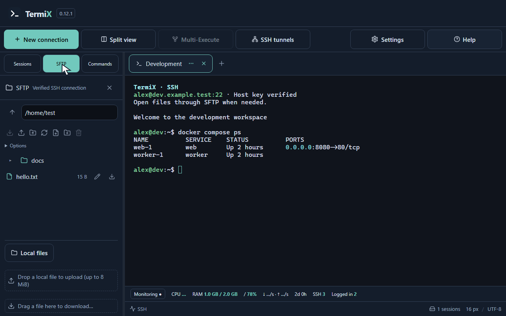

  
  <h1>TermiX</h1>
  
<strong>Your terminal. Your servers. One calm workspace.</strong>

  
A modern SSH, SFTP and terminal workspace built with Rust and Tauri.

  
<a href="https://github.com/TomateMozzarella/TermiX/releases"><strong>Download for Windows</strong></a> · <a href="#see-it-in-action">Watch the demo</a> · <a href="docs/ROADMAP.md">Roadmap</a> · <a href="docs/README.de.md">Deutsch</a>

## A workspace that stays out of your way

Connect to your servers, browse remote files and keep your everyday commands close. TermiX combines a minimal interface with a Rust backend for native processes, SSH and file transfers.

**Windows 11 first. English and German. Dark, light or system appearance.** Other platforms remain a development goal; Windows downloads are available today.

## See it in action

*Captured from the actual production UI using illustrative test data and mocked connections. The animation demonstrates navigation, not a real remote-server connection or a performance benchmark.*

## What you can do

| Workspace | Included |
| --- | --- |
| Terminals | Local shells and SSH; reorder, rename, colour and pin tabs; display up to six existing terminals. |
| Connections | Saved sessions, folders, favourites, recent connections, search and metadata import/export. |
| Remote files | Browse SFTP on the verified SSH connection; upload whole folders or files, download files, create and remove files or empty folders. |
| SSH tunnels | Explicit local/remote TCP forwarding with loopback defaults, active connection counts and Stop. |
| Editing | Integrated Monaco editor, find/replace, read-only comparison, maximize and explicit save to server; optional external editor. |
| Commands | A compact, searchable sidebar for named commands, with Play, double-click and context actions. |
| Monitoring | Read-only Linux CPU, RAM, disk, network, uptime and visible SSH/user metrics. |
| Appearance | Light/dark/system, accent colours, readable font and UI scaling; categorized settings and first-run setup. |

<table>
<tr>
<td width="50%">
<strong>Files alongside your terminal.</strong> A compact toolbar and shared sidebar keep the workspace focused.
</td>
<td width="50%">
<strong>Edit without losing context.</strong> Search, replace and compare, with explicit server saves.
</td>
</tr>
</table>

### New in v0.10

[v0.10.0 is published](https://github.com/TomateMozzarella/TermiX/releases/tag/v0.10.0): local/remote SSH TCP tunnels, whole-folder SFTP uploads including empty subdirectories, clearer light mode, larger settings, direct command execution, optional grouped file reminders and a shorter tab menu with named colour circles. See the [version notes](docs/releases/v0.10.0.md) for limits.

Multi-Execute, detached windows, additional protocols and resumable folder transfers remain [planned](docs/ROADMAP.md).

## Download and get started

1. Open [GitHub Releases](https://github.com/TomateMozzarella/TermiX/releases) and select the newest published development release.
2. Choose **`*-setup.exe`** for installation, **`*.msi`** for MSI deployment, or **`*-portable.zip`** to extract and run without installation.
3. Complete setup, then add a session or open a local shell.

Keep the portable `data` folder when updating. WebView2 Runtime is required. Downloads are currently unsigned, so Windows may show a reputation warning. Checksums and the source/build receipt accompany each release.

## Designed with explicit control

SSH host keys are verified; changed keys require explicit review. Passwords use the Windows credential vault rather than session JSON. External edits require transfer approval and retain remote-conflict checks. Monitoring is read-only. Commands run only when you invoke them; tunnels never restore automatically.

This is active development software. See [security scope and limitations](docs/SECURITY.md), [release notes](docs/releases) and [verified build history](docs/PROJECT-HISTORY.md).

## Build and contribute

Tauri 2 · Rust · React · TypeScript · xterm.js · Monaco

Development now takes place directly on `main`. Windows CI validates the exact source, native integration, browser workflows, packaging, upgrades and portable isolation before publishing immutable release assets.

See the [contributor instructions](AGENTS.md), [development history and build guidance](docs/PROJECT-HISTORY.md) and [roadmap](docs/ROADMAP.md).

126 checks passed for v0.10.0, including both tunnel directions and recursive SFTP. Installer upgrades and portable isolation also passed. [Verified build and delivery history](docs/PROJECT-HISTORY.md).
