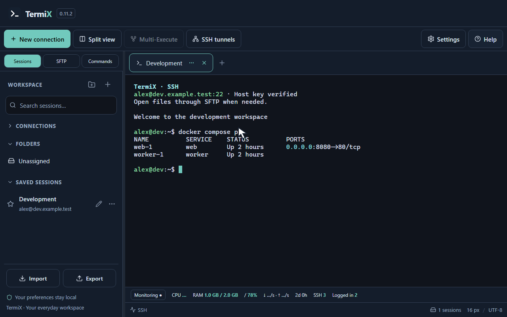
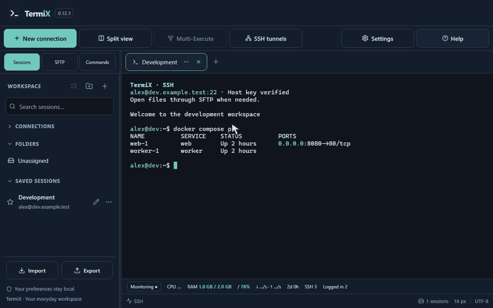
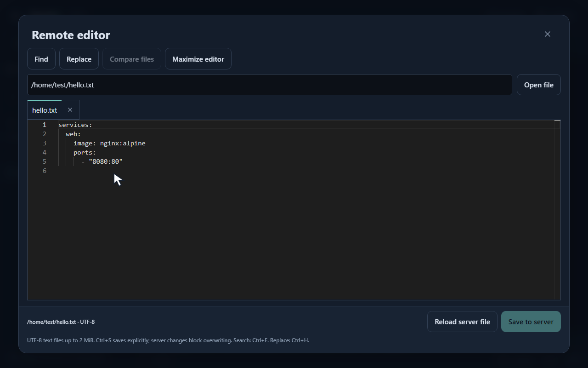
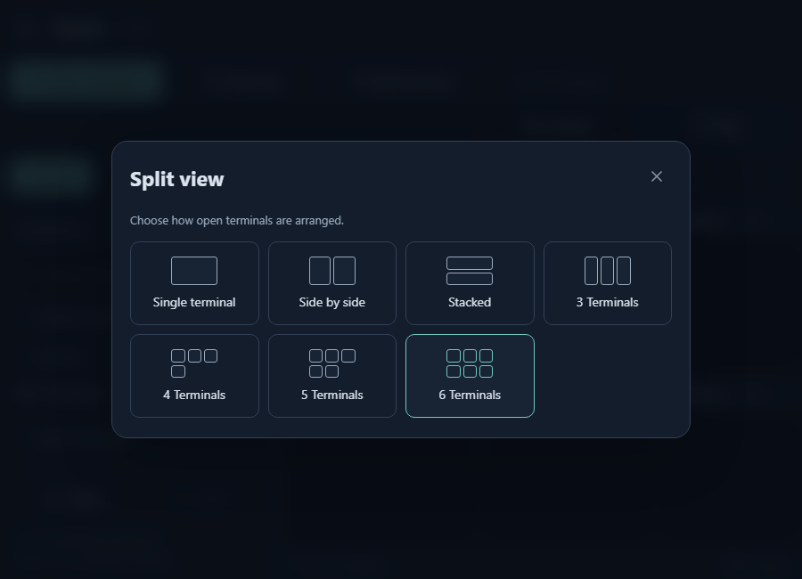
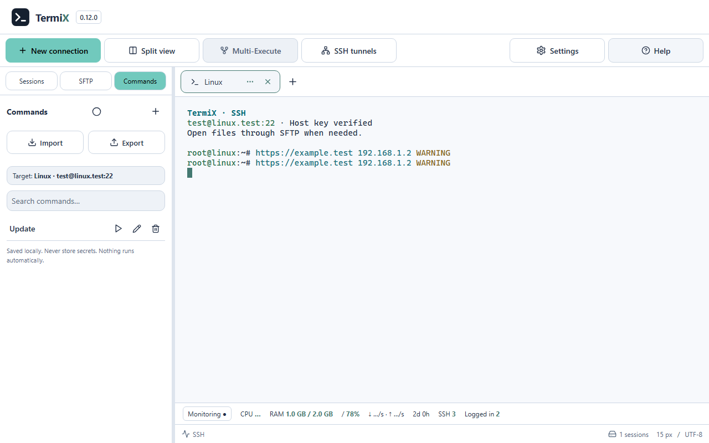

  
  <h1>TermiX</h1>
  
SSH, SFTP and local terminals for Windows, with an integrated editor.

  
<a href="https://github.com/TomateMozzarella/TermiX/releases"><strong>Download for Windows</strong></a> · <a href="#see-it-in-action">Watch the demo</a> · <a href="docs/ROADMAP.md">Roadmap</a> · <a href="docs/README.de.md">Deutsch</a>

## A workspace that stays out of your way

Connect to your servers, browse remote files and keep your everyday commands close. TermiX combines a minimal interface with a Rust backend for native processes, SSH and file transfers.

**Windows 11 first. English and German. Dark, light or system appearance.** Other platforms remain a development goal; Windows downloads are available today.

## See it in action

*Captured from the actual production UI using illustrative test data and mocked connections. The animation demonstrates navigation, not a real remote-server connection or a performance benchmark.*

## What you can do

| Workspace | Included |
| --- | --- |
| Terminals | Local shells and SSH, scrollable tabs with custom colours, up to six panes, and Multi-Execute with a preview of the targets. |
| Connections | Saved sessions, folder search, favourites, scoped JSON import/export, alternate SSH login and SFTP from the session menu. |
| Remote files | Browse SFTP on the verified SSH connection; upload whole folders or files, download files, create and remove files or empty folders. |
| SSH tunnels | Explicit local/remote TCP forwarding with loopback defaults, active connection counts and Stop. |
| Editing | Integrated Monaco editor with find/replace, comparison, explicit server saves and a read-only view of terminal output. External editing is optional. |
| Commands | Search, run, import and export named commands. JSON imports show a preview before adding commands to the library. |
| Monitoring | Read-only SSH metrics for Linux, FreeBSD, macOS and Windows. Available counters depend on the remote system. |
| Appearance | Light/dark/system, accent colours, readable font and UI scaling; categorized settings and first-run setup. |

<table>
<tr>
<td width="50%">
<strong>Files alongside your terminal.</strong> A compact toolbar and shared sidebar keep the workspace focused.
</td>
<td width="50%">
<strong>Edit without losing context.</strong> Search, replace and compare, with explicit server saves.
</td>
</tr>
</table>

### Workspace updates

The [v0.12.0 development notes](docs/releases/v0.12.0.md) cover the TermiX Editor workspace, external file review and saved RDP sessions that open in Windows Remote Desktop.

[v0.11.2](docs/releases/v0.11.2.md) adds custom tab colours, saved command import/export, session and folder context menus, and a read-only terminal output view. The [v0.11.1 notes](docs/releases/v0.11.1.md) cover the toolbar, help, split previews and tab scrolling.

<table>
<tr>
<td width="50%">
Preview the terminal layout before switching.
</td>
<td width="50%">
Manage named commands and move them between installations.
</td>
</tr>
</table>

The current development workspace includes detachable terminals, resumable SFTP downloads, folder retries that preserve identical files, and SSH monitoring for Linux, FreeBSD, macOS and Windows. Native Windows validation is pending for these changes. See the [roadmap](docs/ROADMAP.md) for remaining work.

## Download and get started

1. Open [GitHub Releases](https://github.com/TomateMozzarella/TermiX/releases) and select the newest published development release.
2. Choose **`*-setup.exe`** for installation, **`*.msi`** for MSI deployment, or **`*-portable.zip`** to extract and run without installation.
3. Complete setup, then add a session or open a local shell.

Keep the portable `data` folder when updating. WebView2 Runtime is required. Downloads are currently unsigned, so Windows may show a reputation warning. Checksums and the source/build receipt accompany each release.

## Designed with explicit control

SSH host keys are verified; changed keys require explicit review. Passwords use the Windows credential vault rather than session JSON. External edits require transfer approval and retain remote-conflict checks. Monitoring is read-only. Commands run only when you invoke them; tunnels never restore automatically.

This is active development software. See [security scope and limitations](docs/SECURITY.md), [release notes](docs/releases) and [verified build history](docs/PROJECT-HISTORY.md).

## Build and contribute

Tauri 2 · Rust · React · TypeScript · xterm.js · Monaco

Development now takes place directly on `main`. Windows CI validates the exact source, native integration, browser workflows, packaging, upgrades and portable isolation before publishing immutable release assets.

See the [contributor instructions](AGENTS.md), [development history and build guidance](docs/PROJECT-HISTORY.md) and [roadmap](docs/ROADMAP.md).

126 checks passed for v0.10.0, including both tunnel directions and recursive SFTP. Installer upgrades and portable isolation also passed. [Verified build and delivery history](docs/PROJECT-HISTORY.md).

