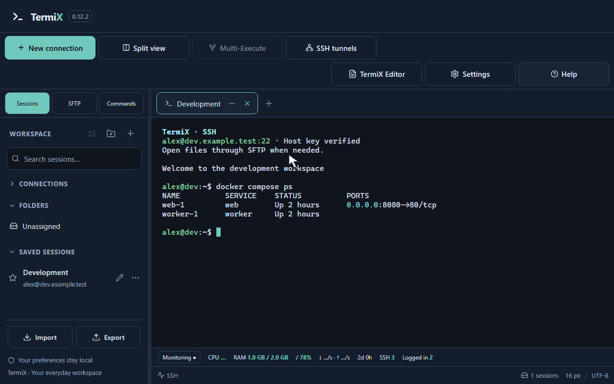
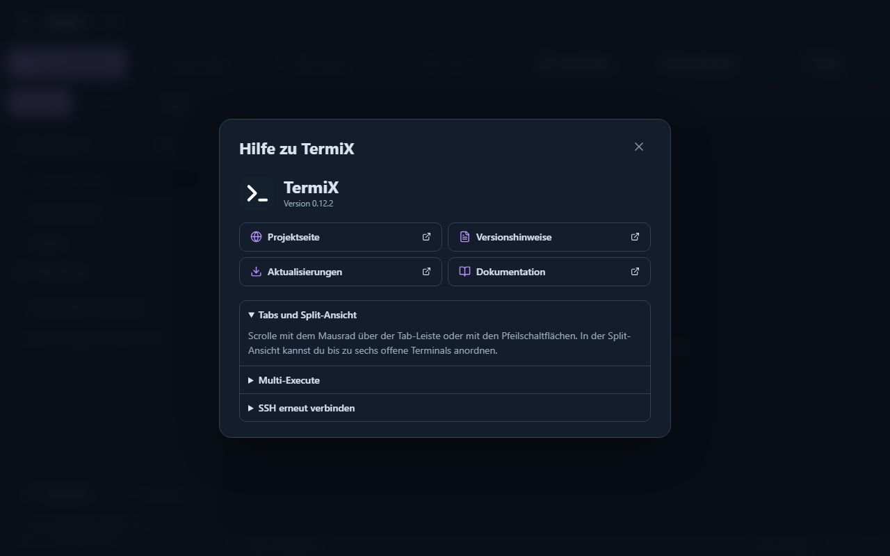

# TermiX

Im aktuellen Entwicklungsstand lassen sich laufende Terminals abtrennen und SFTP-Downloads nach einer Unterbrechung wieder aufnehmen. Wiederholte Ordneruploads überspringen bytegleiche vorhandene Dateien. Das SSH-Monitoring unterstützt Linux, FreeBSD, macOS und Windows.

**Terminal, Server und Dateien in einem übersichtlichen Arbeitsplatz.**

TermiX verbindet lokale Terminals, SSH, SFTP und einen integrierten Editor in einer modernen Oberfläche. Windows 11 steht zuerst im Fokus; Englisch und Deutsch, heller/dunkler Modus und eigene Akzentfarben sind verfügbar.

[Windows herunterladen](https://github.com/TomateMozzarella/TermiX/releases) · [Funktionsumfang und GIF-Demo](../README.md) · [Roadmap](ROADMAP.md)

## Funktionen

[v0.12.2](releases/v0.12.2.md) bringt eine eigene Editorsuche, einen klareren Dateivergleich und schreibgeschützte lokale Datei-Tabs.

[v0.12.1](releases/v0.12.1.md) bringt Makroaufzeichnung direkt im Terminal, erhaltene Editor-Tabs, frei wählbare Vergleichsdateien und eine durchsuchbare lokale SFTP-Ansicht.

- Sitzungen und Ordner per Rechtsklick verwalten und gezielt als JSON importieren oder exportieren. Bei SSH kannst du dich mit einem anderen Benutzernamen verbinden oder SFTP öffnen.
- Terminal-Tabs sortieren, umbenennen, mit einer eigenen Farbe markieren und anheften. Bis zu sechs Terminals gleichzeitig anzeigen und Befehle per Multi-Execute an die bestätigten Ziele senden.
- Dateien über die geprüfte SSH-Verbindung per SFTP übertragen und bearbeiten.
- Monaco mit Suchen, Ersetzen und Dateivergleich oder einen externen Editor verwenden. Terminalausgaben öffnen sich im eingestellten Editor. Beim Wechsel zurück zu SFTP bleiben die Editor-Tabs erhalten.
- Benannte Befehle in der Seitenleiste speichern, ausführen und als JSON importieren oder exportieren.
- Lokale und entfernte TCP-Weiterleitungen über eine geprüfte SSH-Verbindung einrichten.
- CPU, RAM, Speicherplatz und weitere Werte für Linux, FreeBSD, macOS und Windows beobachten. Die verfügbaren Werte hängen vom Zielsystem ab.

[Änderungen in v0.11.2](releases/v0.11.2.md) · [Veröffentlichte Windows-Versionen](https://github.com/TomateMozzarella/TermiX/releases)

Für v0.12.0 kommen der überarbeitete TermiX Editor, die Anzeige externer Dateien in der Statusleiste und gespeicherte RDP-Verbindungen für Windows-Remotedesktop hinzu. [Änderungen in v0.12.0](releases/v0.12.0.md)

## Installation oder portable Nutzung

Unter Releases findest du EXE-Installer, MSI und portable ZIP. Für die portable Nutzung das ZIP entpacken und TermiX.exe starten. Beim Aktualisieren den danebenliegenden data-Ordner behalten. WebView2 wird benötigt; die Builds sind derzeit nicht signiert.

Die Bilder und die GIF-Demo zeigen die echte Oberfläche mit Beispieldaten und simulierten Verbindungen. Sie enthalten keine privaten Serverdaten. Weitere technische Angaben stehen in der [englischen Projektübersicht](../README.md) und den [Sicherheitshinweisen](SECURITY.md).
