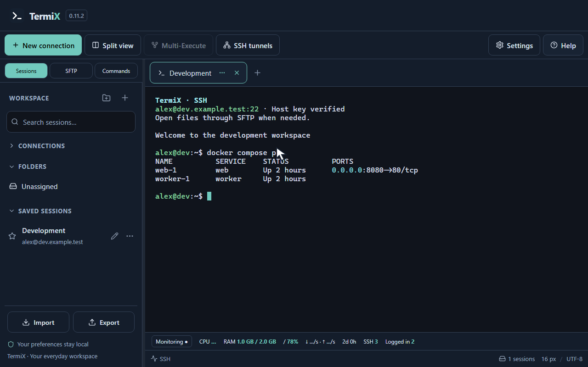

# TermiX 0.10.0 · Tunnels & smoother workflows

A calmer workspace, faster everyday actions and whole-folder transfers.

> **Development prerelease · Windows x64**  
> Save open work before updating. This release is unsigned.

## Download

| Package | Use it when… |
| --- | --- |
| [Windows EXE installer](https://github.com/TomateMozzarella/TermiX/releases/download/v0.10.0/TermiX_0.10.0_x64-setup.exe) | You want the standard installation and shortcuts. |
| [Portable ZIP](https://github.com/TomateMozzarella/TermiX/releases/download/v0.10.0/TermiX_0.10.0_x64-portable.zip) | You want to extract and run TermiX without installing it. |
| MSI in **Assets** below | You need MSI deployment. |
| `SHA256SUMS` + `release-manifest.json` in **Assets** | You want to verify downloads and their exact source/build. |

## New

- **SSH tunnels:** explicitly start local or remote TCP forwarding on an existing verified SSH connection. Choose the target and port, see active connections, and stop the tunnel from its dialog. Nothing restores automatically.
- **Upload entire folders:** choose a local folder in SFTP to transfer files, nested folders and empty directories. Includes aggregate progress, cancellation and opt-in replacement of existing files.
- **A clearer tab menu:** named colour circles, compact Layout/Close groups and keyboard navigation.
- **An SSH welcome:** a short coloured introduction shows the actual connection target and verified host-key status.

## Improved

- Better light-mode contrast for text, controls, status and monitoring.
- A larger settings dialog that keeps its size while categories scroll.
- Saved commands run directly from Play, the context menu or double-click; the target stays visible.
- Open external files share one collapsible reminder. You can switch informational reminders off in Preferred editor settings.
- Changed external files are reviewed one at a time, with explicit transfer approval and conflict protection.
- Development now happens on `main`; the GitHub project page includes screenshots, feature details and a pointer walkthrough.

## Updating

**Installed:** run the new installer and retain your application data. Save editor work before accepting the installer’s offer to close TermiX.

**Portable:** replace application files while keeping the adjacent `data` folder. Windows credentials remain bound to the PC/user/location. WebView2 Runtime is required.

## Known limits

- Builds are unsigned; Windows may show a reputation warning.
- Remote tunnels need server permission. Server policy controls actual remote binding/exposure; choose a numeric destination IP reachable from this PC.
- Folder uploads skip links/special files and report their count; up to 10,000 entries and 32 levels. Already completed files/directories remain after cancellation. Resume and Explorer folder drag/drop are planned.
- Multi-Execute, detached windows and additional protocols are not included.
- Wider server/editor interoperability, interrupted remote-listener cancellation and interactive uninstall choices remain manual validation areas.

The images use illustrative test data, not private server data. See [security scope](https://github.com/TomateMozzarella/TermiX/blob/v0.10.0/docs/SECURITY.md) and the [roadmap](https://github.com/TomateMozzarella/TermiX/blob/main/docs/ROADMAP.md).

**Deutsch:** Neu sind SSH-Tunnel und vollständige Ordner-Uploads. Dazu kommen bessere Lesbarkeit im hellen Modus, größere Einstellungen, direkte Befehlsausführung und übersichtlichere Menüs. Bei portablen Updates bitte den `data`-Ordner behalten.
